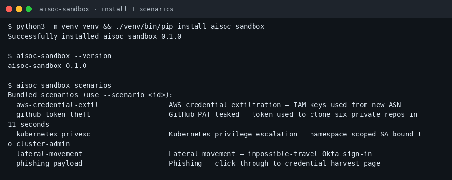
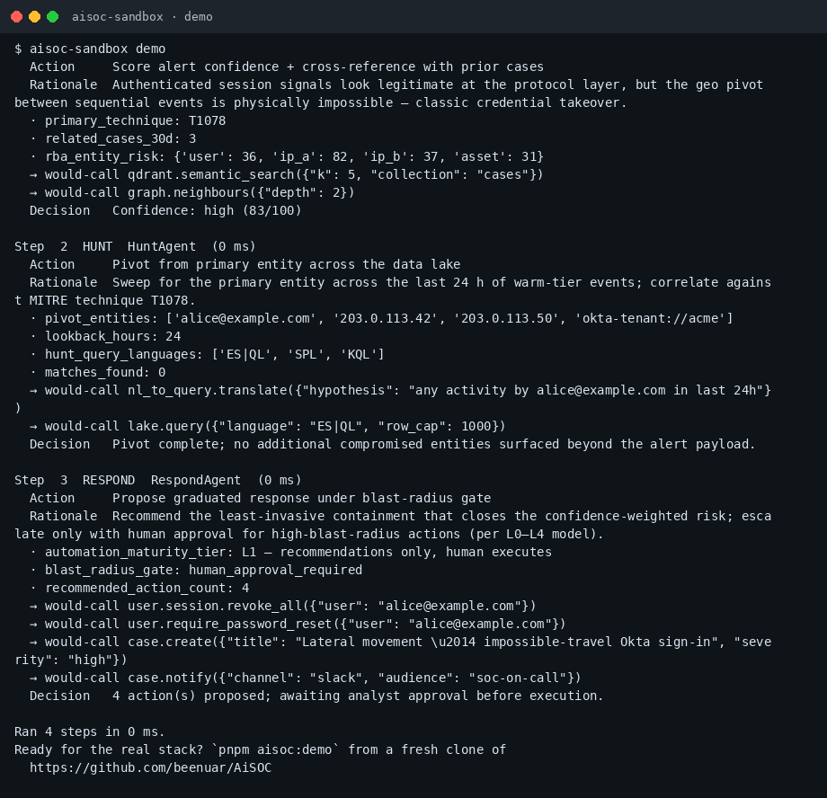
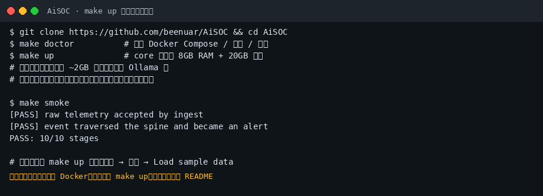

# AiSOC 小白中文教程

> 开源、可自托管的 AI 安全运营中心（SOC）：告警融合、LLM Agent 研判、MITRE ATT&CK、可回放决策账本（社区非官方教程）  
> 上游：[`beenuar/AiSOC`](https://github.com/beenuar/AiSOC) · 文档：[beenuar.github.io/AiSOC](https://beenuar.github.io/AiSOC/)  
> 教程校对：2026-11-02（Asia/Shanghai）· 本机实测 **aisoc-sandbox 0.1.0**（离线 demo；完整 `make up` 需 Docker）

[](https://github.com/xianyu110/awesome-aisoc-zh)
[](https://github.com/beenuar/AiSOC)
[](LICENSE)
[](https://xianyu110.github.io/awesome-aisoc-zh/)

---

## 截图索引

| # | 文件 | 类型 | 说明 |
|---|------|------|------|
| 1 | [`images/01-sandbox-install.png`](images/01-sandbox-install.png) | **真实** | venv 安装 `aisoc-sandbox==0.1.0` + `scenarios` 列表 |
| 2 | [`images/02-demo.png`](images/02-demo.png) | **真实** | `aisoc-sandbox demo`：Detect→Triage→Hunt→Respond 四步账本 |
| 3 | [`images/03-make-up-schematic.png`](images/03-make-up-schematic.png) | **示意图** | 完整栈 `make up` / `make smoke`（本沙盒无 Docker，未实跑） |

---

## 这是什么？

**AiSOC** 把安全遥测接入后做归一化与检测关联，用 AI Agent 研判，并把每一步提示词 / 工具调用写入可审计的 Investigation Ledger；响应默认需人工批准。官方强调 **core 配置可不依赖外部 API Key**：内置 Ollama + 固定本地小模型做真实 triage（非桩）。

本仓库只提供**中文小白教程**（MIT）。上游许可证为 **MIT**。

---

## 官方链接（请以官方为准）

| 资源 | 链接 |
|------|------|
| 源码 | https://github.com/beenuar/AiSOC |
| 文档站 | https://beenuar.github.io/AiSOC/ |
| Technical Guide PDF | 上游 README 顶部徽章链接 |
| 安装要求 | https://beenuar.github.io/AiSOC/docs/installation |

---

## 环境要求（摘要）

**完整栈（官方）**

- Docker Compose v2
- 约 **8 GB** 内存与 **20 GB** 空闲磁盘（Docker VM 内）
- `python3`（3.9+）与 `bash`
- 首次启动会下载约 **2 GB** 本地模型到 volume（仅 `make clean` 清理）

**无 Docker 快速体验（本教程实测）**

```bash
python3 -m venv venv
./venv/bin/pip install aisoc-sandbox
./venv/bin/aisoc-sandbox --version
# aisoc-sandbox 0.1.0
```

---

## 安装路径 A：离线 sandbox（推荐小白先跑通流程）

```bash
python3 -m venv venv && ./venv/bin/pip install aisoc-sandbox
./venv/bin/aisoc-sandbox scenarios
./venv/bin/aisoc-sandbox demo
# 或指定场景：
./venv/bin/aisoc-sandbox demo --scenario aws-credential-exfil
```





sandbox **不启动 Docker、不调用外网 LLM**，用合成剧本走完 Detect → Triage → Hunt → Respond，帮助理解账本与人工批准边界。

---

## 安装路径 B：完整自托管（官方一键）

> 命令摘自官方 README。版本与资源数字以你安装当天的官方文档为准。

```bash
git clone https://github.com/beenuar/AiSOC && cd AiSOC
make doctor    # 检查依赖
make up        # core ≈ 16 服务 / ~8GB
# Windows 可用官方 install.ps1；Linux/macOS 也可用 install.sh 装前置
make smoke     # 端到端灌一条事件，看 PASS/FAIL
```



`make up` 会生成 `.env` 中的多项密钥，并**只打印一次**管理员密码——请自行安全保存，**不要**提交到 Git 或发到聊天群。

登录控制台后可用向导 **Load sample data**（走真实 ingest 路径的示例场景）。更大合成集：`make demo`。

可选配置：

| 配置 | 命令 | 说明 |
|------|------|------|
| core | `make up` | 告警全链路 + 本地 LLM gateway |
| full | `make up-full` | + event lake / 图 / 搜索等（约 12GB） |
| GPU / 本机已有 Ollama | 见官方 `where-the-model-runs` 文档 | `make up-gpu` / `make up-host-llm` 等 |

**模型接入合规建议**：优先使用官方捆绑的本地 Ollama、或你已有的 **DeepSeek / 国内兼容 OpenAI 端点 / 自建 Ollama**。不要把生产密钥写进仓库；本教程不硬推未备案境外中转。

---

## 第一次演示任务（建议）

1. 先跑通路径 A 的 `aisoc-sandbox demo`，读懂 Ledger 四步  
2. 有 Docker 资源后 `make up` → `make smoke`  
3. 控制台加载 sample data，点开一条告警看 Investigation Rail  
4. 用 `make ingest-token` 拿到 token 后，按官方示例 `curl` 推一条合成事件（**勿**用真实客户数据做公开演示）  
5. 可选：把 MCP server 接到 Claude / Cursor / Continue（见官方文档）——本机 agent 仍优先本地 / 国内兼容模型

---

## 常见报错与解决

| 现象 | 可能原因 | 处理 |
|------|----------|------|
| `make doctor` 失败 | 无 Docker / 内存不足 | 按官方 Installation 补齐；或先用 sandbox |
| 端口被占用 | 本机已有 5432 / 11434 等 | 官方称会自动改端口并打印新地址 |
| 忘记管理员密码 | 只显示一次 | `make bootstrap ARGS=--reset-password`（以官方为准） |
| 模型下载失败 | 出网受限 | 配置可达的镜像策略或使用 `up-host-llm` 指向已有 Ollama |
| pip 报 externally-managed-environment | Debian/Ubuntu PEP 668 | 用 venv / pipx，不要强行 `--break-system-packages` |
| 把 `.env` 提交到 Git | 误操作 | 立刻轮换全部密钥；教程仓永不收录真实密钥 |

---

## 许可证与合规

- **本教程文字与配图**：MIT（见 [LICENSE](LICENSE)）  
- **上游 AiSOC**：MIT  
- 安全数据与告警可能含敏感信息：演示只用官方 sample / synthetic；生产环境遵守你所在地的数据合规要求  
- 模型优先本地 Ollama / DeepSeek / 国内兼容端  
- 可选软链：[tryallapi.com](https://tryallapi.com/?aff=5A6A)（aff=5A6A）；店铺仅 [MaynorAI](https://wzyp.cn/shop/maynorai)

与 beenuar / AiSOC 官方**无隶属关系**。检测规则数量、评分等数字以官方 README / 文档为准。

---

## GitHub Pages

图文镜像页：https://xianyu110.github.io/awesome-aisoc-zh/
